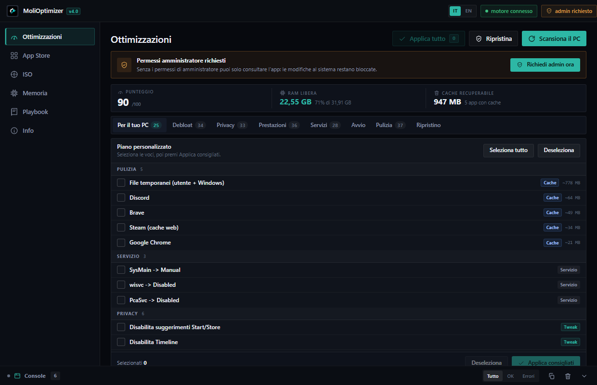
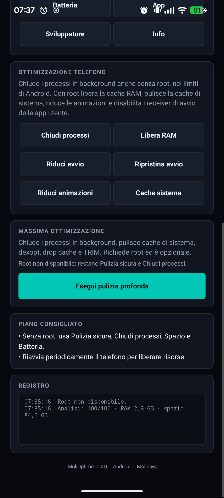

<p align="center">
  
</p>

<h1 align="center">MoliOptimizer 4.0</h1>

<p align="center">
  <strong>Ottimizzazione Windows su misura, con backup e ripristino.</strong><br>
  Due edizioni Windows con lo stesso motore, più un'app Android nativa.
</p>

<p align="center">
  
  
  
  
  
</p>

<p align="center">
  <a href="https://github.com/Molinays/MoliOptimizer/releases/latest"><strong>Download</strong></a>
  &nbsp;·&nbsp;
  <a href="#novità-in-40">Novità 4.0</a>
  &nbsp;·&nbsp;
  <a href="#funzioni">Funzioni</a>
  &nbsp;·&nbsp;
  <a href="#protezione">Protezione</a>
  &nbsp;·&nbsp;
  <a href="#android">Android</a>
  &nbsp;·&nbsp;
  <a href="#licenza">Licenza</a>
</p>

> **MoliOptimizer è software proprietario, non open source.** Il repository non concede diritti di modifica o ridistribuzione del codice. Vedi [Licenza](#licenza).

---

## Screenshot

<p align="center">
  
</p>

<p align="center"><sub>MoliOptimizer Web 4.0 su Windows: piano personalizzato, stato del PC e console del motore.</sub></p>

<p align="center">
  
</p>

<p align="center"><sub>MoliOptimizer 4.0 su Android: azioni per processi, RAM, avvio, animazioni e cache di sistema.</sub></p>

---

## Novità in 4.0

- **Build 4.0 ufficiale.** Windows, web, launcher e Android sono allineati a `4.0.0`; gli artefatti stanno in `dist/v4`.
- **Fast IT/EN protette.** Il bundle PowerShell non è più in chiaro: viene compresso con GZip, cifrato con AES-256-CBC, autenticato con HMAC-SHA256 e incorporato come risorsa binaria.
- **Web protette.** Web Host e WebSingle usano il payload cifrato (`Runtime.bin`) e il self-test verifica payload, UI, bridge e runtime.
- **Android più operativo.** R8 offusca il DEX; nuove azioni root per cache di sistema, animazioni, processi, RAM e receiver di avvio. Senza root resta la chiusura dei processi tramite `killBackgroundProcesses`.
- **Build più verificabile.** Ogni artefatto ha checksum SHA-256 separato; la build esegue self-test di Fast, Web Host e WebSingle.
- **Nessuna promessa di zero rilevazioni.** L'offuscamento protegge il codice, ma può aumentare le euristiche antivirus. Firma trusted e riclassificazione vendor restano necessarie per i falsi positivi.

---

## Download

| Pacchetto | Formato | Piattaforma | Note |
|---|---|---|---|
| **MoliOptimizer** · `MoliOptimizer.exe` | `.exe` singolo (1,47 MB) | Windows 10/11 x64 | Launcher nativo; host WebView2 protetto; estrae host e DLL in `%LOCALAPPDATA%`; richiede WebView2 Runtime |
| **MoliOptimizer Web Host** · `MoliOptimizer-Web.exe` | `.exe` + DLL WebView2 (427 KB) | Windows 10/11 x64 | Host WebView2; va eseguito dalla propria cartella |
| **MoliOptimizerFast IT** · `MoliOptimizerFast-IT.exe` | `.exe` (124 KB) | Windows 7/10, PowerShell 5.1 | Host .NET in-process, payload cifrato, nessun WebView2, interfaccia italiana |
| **MoliOptimizerFast EN** · `MoliOptimizerFast-EN.exe` | `.exe` (137 KB) | Windows 7/10, PowerShell 5.1 | Host .NET in-process, payload cifrato, nessun WebView2, interfaccia inglese |

Scarica l'ultima release da [GitHub Releases](https://github.com/Molinays/MoliOptimizer/releases/latest). Gli hash SHA-256 sono pubblicati in `dist/v4/SHA256SUMS.txt`.

Nessun installer e nessun servizio persistente. La scansione iniziale è in sola lettura; le modifiche richiedono selezione, conferma e, per le operazioni privilegiate, UAC.

### Cosa c'è in `dist/v4`

- `MoliOptimizer.exe` è la **WebSingle**: un solo file con launcher nativo, host WebView2 e DLL incorporati. Non è una copia di `web/`; estrae il pacchetto in `%LOCALAPPDATA%\MoliOptimizer\WebSingle\4.0.0-*` e avvia l'host.
- `web/MoliOptimizer-Web.exe` è l'**host WebView2**: va eseguito con le DLL WebView2 che ha accanto. È la variante da cartella, più piccola.
- `classic/` contiene **MoliOptimizerFast** IT/EN, l'edizione WinForms per Windows 7/10 con PowerShell 5.1.
- `SHA256SUMS.txt` copre tutti gli exe della release.

La vecchia `dist/v3` resta solo come archivio della serie 3.5.

---

## Android

La cartella [`android/`](android/README.md) contiene una **APK nativa per Android 7+**, separata dalla release Windows. Non è un porting 1:1: Android non ha registro o servizi Windows, quindi l'app implementa le azioni realmente disponibili.

- Scansione di RAM, spazio, batteria, temperatura, rete e sistema con punteggio locale.
- Piano consigliato e toggle IT/EN.
- Pulizia sicura della cache dell'app e scorciatoie alle impostazioni di sistema.
- **Chiusura dei processi in background anche senza root**, nei limiti di `killBackgroundProcesses`.
- **Con root**: `am kill-all`, pulizia cache RAM, pulizia cache di sistema, riduzione animazioni, disabilitazione dei receiver di avvio delle app utente e ripristino.
- **Pulizia profonda** con `am kill-all`, `pm trim-caches`, dexopt, `drop_caches` e `fstrim`.
- DEX offuscato con R8; nessun permesso Internet, nessun analytics, nessuna connessione in background.

APK generato in `android/dist/MoliOptimizer-4.0.0-android.apk` (cartella locale, esclusa da Git) con checksum separato. Istruzioni e limiti: [`android/README.md`](android/README.md). La build è firmata con chiave debug per il test; per la distribuzione serve una chiave release.

---

## Funzioni

### Piano personalizzato
- Lettura di CPU, GPU, RAM, dischi, sistema operativo, app installate, servizi e voci di avvio.
- Punteggio del PC con dettaglio per memoria, spazio disco, servizi, debloat e avvio.
- Piano costruito sull'hardware reale, non un preset uguale per tutti.
- Profili AMD, Intel e NVIDIA, con tweak mirati quando compatibili: HAGS, ULPS, piano Ryzen, boost CPU e telemetria NVIDIA.
- Applicazione selettiva: nessuna modifica parte senza scelta e conferma.

### Privacy e reattività
- Telemetria, ID pubblicitario, suggerimenti Start/Store, Timeline, widget, Copilot e Recall.
- Cronologia appunti cloud, raccolta input/inchiostro, schermata di blocco Spotlight.
- AutoPlay/AutoRun, SMB1, WPAD, Assistenza remota e Desktop remoto.
- Piano energetico, Fast Startup, TRIM, Core Parking, priorità foreground, Game Mode e Game DVR.
- MMCSS, QoS riservata, Nagle TCP, menu senza ritardo, chiusura app più rapida e animazioni della taskbar.
- Verifica del valore scritto per i tweak di registro: un errore non viene presentato come successo.

### Debloat, servizi e avvio
- Rimozione delle app preinstallate selezionate con `Remove-AppxPackage` e `Remove-AppxProvisionedPackage`.
- Le voci protette o non rimosse vengono segnalate, non conteggiate come completate.
- Tipo di avvio dei servizi: automatico, manuale o disabilitato, con arresto e verifica finale.
- Backup dello stato precedente di servizi e voci di avvio.
- Disattivazione delle voci di avvio tramite `StartupApproved` e verifica reale della scrittura.

### Pulizia, RAM e deep clean
- Cache, file temporanei e residui delle applicazioni.
- Dimensioni reali e cache rilevate dopo la scansione.
- Le cartelle in uso possono essere saltate; il risultato riporta lo spazio effettivamente liberato.
- Ottimizzazione RAM e deep clean restano disponibili e non vengono ridotti dalle modalità rapide.

### App Store, ISO e Playbook
- App Store con catalogo winget e icone locali.
- ISO con link ai download ufficiali.
- Playbook con progetti e tool della community.
- Ricerca e filtri locali, interfaccia IT/EN.

### Ripristino
- Ripristino del backup creato prima delle ottimizzazioni.
- Ripristino dei valori predefiniti di Windows per i tweak applicati.
- Servizi, voci di avvio e valori di registro vengono riapplicati dal backup.
- Le app rimosse con Debloat richiedono una reinstallazione manuale.

---

## Protezione e falsi positivi

La release 4.0 è **offuscata**:

- **Fast:** bundle PowerShell compresso, cifrato e autenticato, incorporato come risorsa binaria. L'host lo decifra solo in memoria e lo esegue in-process con PowerShell 5.1. Non viene creato alcun `.ps1` in `%TEMP%` e non viene usato `ps2exe`.
- **Web Host e WebSingle:** UI, bridge e helper sono in un payload cifrato dentro l'exe. La UI viene servita a WebView2 tramite `WebResourceRequested`, senza listener `127.0.0.1`.
- **WebSingle:** un launcher nativo x64 incorpora host e DLL WebView2 in un contenitore non compresso, li estrae in `%LOCALAPPDATA%` e avvia l'host.
- **Bridge web:** viene scritto solo in una cartella runtime nascosta, con nome legato al payload e al processo, e cancellato alla chiusura.
- **Android:** R8 rinomina e riduce il DEX; `MainActivity` resta l'unica classe pubblica necessaria al manifest.

L'offuscamento **non garantisce zero rilevazioni**. Al contrario, packer e payload cifrati possono attivare euristiche ML. Per ridurre davvero i falsi positivi servono una firma Authenticode con certificato trusted e la riclassificazione presso i vendor; senza certificato nessun rebuild può garantirlo.

Per una variante trasparente di diagnosi o per i vendor che richiedono una build non offuscata:

```powershell
.\build\Build-All.ps1 -Transparent
```

Questa variante non è la release ufficiale: se la esegui, ricostruisci poi la release protetta prima di distribuire.

La procedura per i vendor è in [docs/security/false-positive-mcafee-secureage.md](docs/security/false-positive-mcafee-secureage.md).

> Se hai usato build precedenti alla 4.0, elimina le vecchie cartelle `%LOCALAPPDATA%\MoliOptimizer\WebSingle\3.*` prima di distribuire il PC: contengono i payload delle versioni vecchie. Le build 4.0 usano `4.0.0-*`.

---

## Sicurezza e ripristino

- La scansione iniziale **non modifica** il sistema.
- Le operazioni privilegiate richiedono **UAC/amministratore**.
- Prima delle modifiche viene creato, quando possibile, un **punto di ripristino di Windows**.
- MoliOptimizer salva in `%ProgramData%\MoliOptimizer\optimization-backup.xml`:
  - valori di registro precedenti;
  - stato e tipo di avvio dei servizi;
  - stato `StartupApproved` delle voci di avvio;
  - piano energetico, ibernazione, Core Parking e Dynamic Tick.
- La funzione **Ripristina** usa questo backup.
- Le modifiche più aggressive sono manuali e chiaramente etichettate; le app rimosse con Debloat non sono ripristinabili automaticamente.
- L'app non installa servizi persistenti, driver o componenti di controllo remoto.

> Le ottimizzazioni modificano registro, servizi e alimentazione. Usa l'app su un PC di cui hai il controllo e leggi sempre la descrizione della voce prima di applicarla.

---

## Edizioni Windows

| | **MoliOptimizer Web** | **MoliOptimizerFast** |
|---|---|---|
| Interfaccia | HTML/CSS/JS in WebView2 | WinForms nativa |
| Windows | 10/11 x64 | 7/10, 32 o 64 bit |
| Runtime | WebView2 Runtime | PowerShell 5.1 |
| Installazione | Nessun installer; file singolo o cartella portabile | Nessun installer |
| Lingua | Toggle IT/EN a runtime | Build IT ed EN separate |
| Ideale per | PC moderni e UI più aggiornabile | PC datati e ambienti senza WebView2 |
| Motore | PowerShell modulare | PowerShell modulare |
| Backup | Sì | Sì |
| Payload | Cifrato | Cifrato |

Entrambe le edizioni usano lo stesso motore, gli stessi cataloghi e lo stesso formato di backup. La web è più comoda da aggiornare; Fast è la scelta quando WebView2 non è disponibile o le risorse sono limitate.

---

## Requisiti

### Edizione web
- Windows 10 o Windows 11 aggiornato, x64.
- WebView2 Runtime. Su Windows 10/11 recenti è già presente; se manca, l'app lo segnala.
- Nessun runtime Node o Electron richiesto per usare l'exe.
- Per la build Tauri opzionale: Rust, MSVC Build Tools e WebView2.

### MoliOptimizerFast
- Windows 7 o Windows 10, 32 o 64 bit.
- PowerShell 5.1.
- Nessuna dipendenza da WebView2, Electron o runtime esterni.
- Le operazioni su registro, servizi, Appx e alimentazione richiedono elevazione.

La durata della scansione dipende da CPU, disco, servizi e app installate. Il piano viene calcolato localmente.

---

## Come si usa

1. Avvia l'app.
2. Premi **Scansiona il PC**.
3. Controlla il piano nella scheda **Per il tuo PC**.
4. Apri Debloat, Privacy, Prestazioni, Servizi, Avvio o Pulizia per scegliere le singole voci.
5. Seleziona le voci e premi **Applica**.
6. Controlla il risultato nella console e nella notifica finale.
7. Usa **Ripristina** se vuoi tornare allo stato precedente.

L'app non applica nulla senza una selezione esplicita e una conferma. Le operazioni privilegiate possono richiedere UAC.

---

## Aggiornamenti

La versione applicazione è **4.0.0**. La release più recente è disponibile su GitHub:

https://github.com/Molinays/MoliOptimizer/releases/latest

- **Web:** la scheda Info controlla `releases/latest`, mostra la versione corrente e segnala se esiste una release più nuova.
- **MoliOptimizerFast:** la scheda Info mostra versione, autore e licenza; il pulsante **Verifica aggiornamenti** interroga GitHub.
- Se GitHub non è raggiungibile, l'app resta utilizzabile e mostra **Controllo non disponibile**. Il collegamento alla pagina release resta disponibile.

MoliOptimizer non installa aggiornamenti in background e non esegue modifiche automatiche.

---

## Sviluppo e build

<details>
<summary>Comandi per i maintainer</summary>

Il motore resta modulare in `src/`, la GUI web in `web/`, gli script di build in `build/`. La cartella `Old/` contiene solo versioni storiche e non viene usata dalla build.

```powershell
# Build completa Windows v4: Fast IT/EN, Web Host e WebSingle protetti
.\build\Build-All.ps1

# Variante trasparente per diagnosi/vendor
.\build\Build-All.ps1 -Transparent

# Build APK Android v4 (R8 + firma debug)
.\android\build-apk.ps1

# Solo MoliOptimizerFast protetta
.\build\Build-Exe.ps1 -Lang IT -Protect
.\build\Build-Exe.ps1 -Lang EN -Protect

# Web Host protetto
.\build\Build-WebHost.ps1 -Protect

# Web in un solo file protetto
.\build\Build-WebSingle.ps1 -Protect -WebOut dist\v4\web -OutFile dist\v4\MoliOptimizer.exe

# Solo sviluppo: guscio Tauri, finisce in dist/dev/web
.\build\Build-Web.ps1
```

Per l'anteprima web:

```powershell
cd web
npm run dev
# http://127.0.0.1:5178
```

`Build-WebHost.ps1` è il percorso di release web: incorpora UI e motore in un payload cifrato e serve la UI dalla memoria, senza server HTTP. `Build-WebSingle.ps1` richiede `gcc` e `windres` (MinGW-w64 x86_64) e produce il launcher nativo. Il guscio Tauri (`Build-Web.ps1`) resta solo per lo sviluppo e non va usato per distribuire una build sorgente.

Verifiche principali:

```powershell
.\build\Test-Syntax.ps1
.\build\Test-SearchFilters.ps1
.\build\Test-Startup.ps1
```

Se un exe è aperto, la build deve fallire con un messaggio chiaro: non dichiarare mai un falso successo. I bundle classici in chiaro vengono creati solo in `%TEMP%` e rimossi a fine build; in `dist/v4` non restano sorgenti: solo exe, DLL WebView2, favicon e `SHA256SUMS.txt`.

La release ufficiale usa `dist/v4`; `dist/v3` resta l'archivio della 3.5.

</details>

---

## Licenza

**MoliOptimizer è software proprietario. Non è open source.**

Copyright © 2026 Molinays. Tutti i diritti riservati.

Nessun permesso è concesso per usare, copiare, modificare, unire, pubblicare, distribuire, sublicenziare o vendere il codice sorgente, in tutto o in parte, senza il consenso scritto preventivo di Molinays.

L'applicazione compilata può essere usata per scopi personali o aziendali interni. La ridistribuzione dell'applicazione compilata, con o senza modifiche, richiede il consenso scritto preventivo di Molinays.

Il testo completo è disponibile in [LICENSE](LICENSE).

Per permessi e richieste: apri una issue nel repository o contatta **Molinays**.

---

## Disclaimer

MoliOptimizer non è affiliato a Microsoft. Windows è un marchio di Microsoft Corporation.

Le ottimizzazioni possono modificare il comportamento del sistema operativo. Verifica sempre il piano, usa il ripristino disponibile e non applicare voci che non comprendi. L'uso dell'app avviene a tuo rischio.
Questa cosa la scrivo per sicurezza, l'app è testata e funziona bene.

<p align="center">
  <strong>Made by Molinays</strong><br>
  <sub>MoliOptimizer 4.0 · Windows 7/10/11 · Android 7+</sub>
</p>
