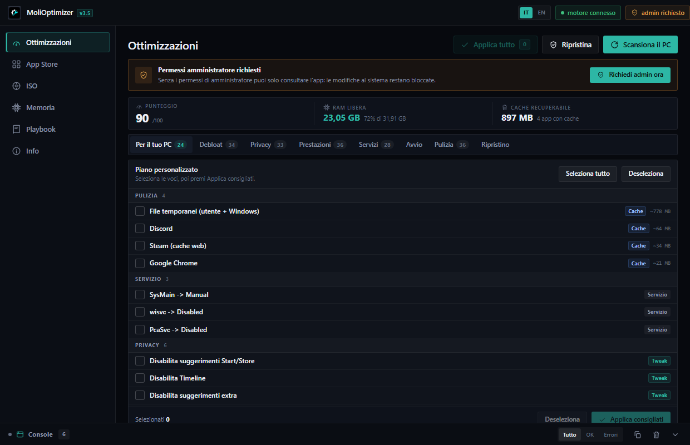
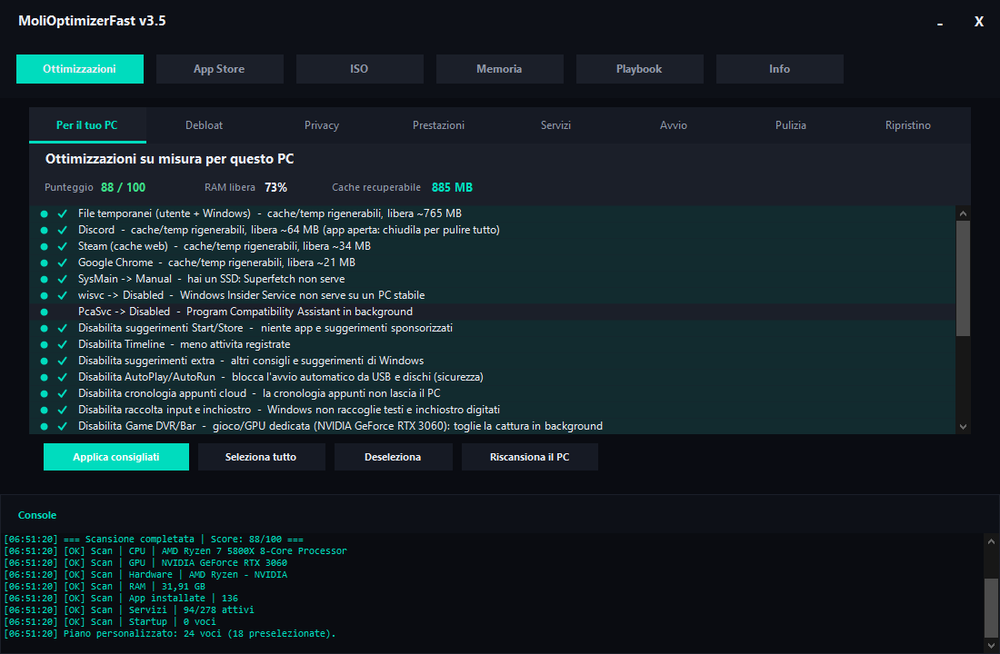
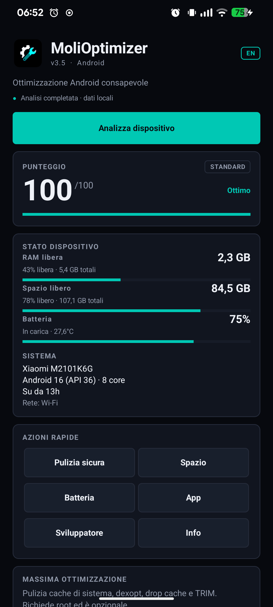

<p align="center">
  
</p>

<h1 align="center">MoliOptimizer 3.5</h1>

<p align="center">
  <strong>Ottimizzazione Windows su misura, con backup e ripristino.</strong><br>
  Due edizioni Windows con lo stesso motore, più un'app Android nativa.
</p>

<p align="center">
  
  
  
  
  
</p>

<p align="center">
  <a href="https://github.com/Molinays/MoliOptimizer/releases/latest"><strong>Download</strong></a>
  &nbsp;·&nbsp;
  <a href="#novità-in-35">Novità 3.5</a>
  &nbsp;·&nbsp;
  <a href="#funzioni">Funzioni</a>
  &nbsp;·&nbsp;
  <a href="#protezione">Protezione</a>
  &nbsp;·&nbsp;
  <a href="#android">Android</a>
  &nbsp;·&nbsp;
  <a href="#licenza">Licenza</a>
</p>

> **MoliOptimizer è software proprietario, non open source.** Il repository non concede diritti di modifica o ridistribuzione del codice. Vedi [Licenza](#licenza).

---

## Screenshot

<p align="center">
  
</p>

<p align="center"><sub>MoliOptimizer Web 3.5 su Windows: piano personalizzato, stato del PC e console del motore.</sub></p>

<p align="center">
  
</p>

<p align="center"><sub>MoliOptimizerFast 3.5: interfaccia WinForms nativa, scansione reale e piano consigliato.</sub></p>

---

## Novità in 3.5

- **Build 3.5.** Riallineati Windows, web, launcher e Android alla versione `3.5.0`, con rebuild completo e checksum aggiornati.
- **Popup Fast finalmente cliccabili.** Il filtro globale dei click veniva sospeso solo per le finestre normali, non per i dialoghi modali: ora conferma e resoconto restano interattivi e il filtro viene ripristinato alla chiusura.
- **Popup più compatti.** Eliminati kicker e spaziature superflue; i messaggi lunghi hanno un'area scorrevole e i pulsanti hanno un click esplicito.
- **Icona ufficiale ovunque.** Splash, finestra principale e taskbar usano l'icona della v1, non più il segnaposto predefinito di WinForms.
- **GUI web più sobria.** Rimossi sottotitoli, punteggi duplicati e scritte promozionali; angoli a 3 px, niente gradienti o animazioni decorative.
- **Distribuzione più lineare.** Fast usa un host .NET in-process senza `ps2exe`; Web e WebSingle servono la UI dalla memoria senza aprire un server HTTP locale.
- **Versione e documentazione allineate.** Titoli, manifest, pacchetto web, build single-file e controllo aggiornamenti riportano `3.5.0`.
- **Edizione Android 3.5.** APK nativa separata, con scansione del dispositivo, piano locale, pulizia sicura e modalità root opzionale. Vedi [android/README.md](android/README.md).

---

## Download

| Pacchetto | Formato | Piattaforma | Note |
|---|---|---|---|
| **MoliOptimizer** · `MoliOptimizer.exe` | `.exe` singolo (1,47 MB) | Windows 10/11 x64 | Launcher nativo; estrae host e DLL in `%LOCALAPPDATA%`; richiede WebView2 Runtime |
| **MoliOptimizer Web Host** · `MoliOptimizer-Web.exe` | `.exe` + DLL WebView2 (427 KB) | Windows 10/11 x64 | Avvio rapido; va eseguito dalla propria cartella |
| **MoliOptimizerFast IT** · `MoliOptimizerFast-IT.exe` | `.exe` (364 KB) | Windows 7/10, PowerShell 5.1 | Host .NET in-process, payload in chiaro, nessun WebView2, interfaccia italiana |
| **MoliOptimizerFast EN** · `MoliOptimizerFast-EN.exe` | `.exe` (408 KB) | Windows 7/10, PowerShell 5.1 | Host .NET in-process, payload in chiaro, nessun WebView2, interfaccia inglese |

Scarica l'ultima release da [GitHub Releases](https://github.com/Molinays/MoliOptimizer/releases/latest). Gli hash SHA-256 sono pubblicati in `dist/v3/SHA256SUMS.txt`.

Nessun installer e nessun servizio persistente. La scansione iniziale è in sola lettura; le modifiche richiedono selezione, conferma e, per le operazioni privilegiate, UAC.

---

## Android

La cartella [`android/`](android/README.md) contiene una **APK nativa per Android 7+**, separata dalla release Windows. Non è un porting 1:1: Android non ha registro o servizi Windows, quindi l'app implementa le azioni realmente disponibili.

<p align="center">
  
</p>

- Scansione di RAM, spazio, batteria, temperatura, rete e sistema con punteggio locale.
- Piano consigliato e toggle IT/EN.
- Pulizia sicura della cache dell'app e scorciatoie alle impostazioni di sistema.
- Modalità root opzionale per `pm trim-caches`, dexopt, `drop_caches` e `fstrim`.
- Nessun permesso Internet, nessun analytics, nessuna connessione in background.

APK generato in `android/dist/MoliOptimizer-3.5.0-android.apk` (cartella locale, esclusa da Git) con checksum separato. Istruzioni e limiti: [`android/README.md`](android/README.md). La build è firmata con chiave debug per il test; per la distribuzione serve una chiave release.

---

## Funzioni

### Piano personalizzato
- Lettura di CPU, GPU, RAM, dischi, sistema operativo, app installate, servizi e voci di avvio.
- Punteggio del PC con dettaglio per memoria, spazio disco, servizi, debloat e avvio.
- Piano costruito sull'hardware reale, non un preset uguale per tutti.
- Profili AMD, Intel e NVIDIA, con tweak mirati quando compatibili: HAGS, ULPS, piano Ryzen, boost CPU e telemetria NVIDIA.
- Applicazione selettiva: nessuna modifica parte senza scelta e conferma.

### Privacy e reattività
- Telemetria, ID pubblicitario, suggerimenti Start/Store, Timeline, widget, Copilot e Recall.
- Cronologia appunti cloud, raccolta input/inchiostro, schermata di blocco Spotlight.
- AutoPlay/AutoRun, SMB1, WPAD, Assistenza remota e Desktop remoto.
- Piano energetico, Fast Startup, TRIM, Core Parking, priorità foreground, Game Mode e Game DVR.
- MMCSS, QoS riservata, Nagle TCP, menu senza ritardo, chiusura app più rapida e animazioni della taskbar.
- Verifica del valore scritto per i tweak di registro: un errore non viene presentato come successo.

### Debloat, servizi e avvio
- Rimozione delle app preinstallate selezionate con `Remove-AppxPackage` e `Remove-AppxProvisionedPackage`.
- Le voci protette o non rimosse vengono segnalate, non conteggiate come completate.
- Tipo di avvio dei servizi: automatico, manuale o disabilitato, con arresto e verifica finale.
- Backup dello stato precedente di servizi e voci di avvio.
- Disattivazione delle voci di avvio tramite `StartupApproved` e verifica reale della scrittura.

### Pulizia, RAM e deep clean
- Cache, file temporanei e residui delle applicazioni.
- Dimensioni reali e cache rilevate dopo la scansione.
- Le cartelle in uso possono essere saltate; il risultato riporta lo spazio effettivamente liberato.
- Ottimizzazione RAM e deep clean restano disponibili e non vengono ridotti dalle modalità rapide.

### App Store, ISO e Playbook
- App Store con catalogo winget e icone locali.
- ISO con link ai download ufficiali.
- Playbook con progetti e tool della community.
- Ricerca e filtri locali, interfaccia IT/EN.

### Ripristino
- Ripristino del backup creato prima delle ottimizzazioni.
- Ripristino dei valori predefiniti di Windows per i tweak applicati.
- Servizi, voci di avvio e valori di registro vengono riapplicati dal backup.
- Le app rimosse con Debloat richiedono una reinstallazione manuale.

---

## Distribuzione e falsi positivi

Le build pubbliche 3.5 non usano `ps2exe`, non aprono un server HTTP locale e non cifrano il payload:

- **Fast:** il bundle PowerShell viene incorporato in chiaro in un host .NET che lo esegue in-process con PowerShell 5.1. Non viene creato alcun `.ps1` in `%TEMP%`, non c'è un payload compresso/cifrato e non c'è il wrapper `ps2exe` che generava la famiglia `MSIL.Krypt`.
- **Web Host:** UI, bridge e helper sono in un payload ZIP compresso dentro l'exe. La UI viene servita a WebView2 tramite `WebResourceRequested`, senza listener `127.0.0.1` e senza una cartella `ui` accanto al programma.
- **WebSingle:** un launcher nativo x64 incorpora host e DLL WebView2 in un contenitore non compresso, li estrae in `%LOCALAPPDATA%` e avvia l'host. Il file esterno non è un assembly .NET.
- **Bridge web:** viene scritto solo in una cartella runtime nascosta, con nome legato al payload e al processo, e cancellato alla chiusura.
- **Nessun sorgente sciolto in `dist/v3`:** la build verifica che non restino `.ps1`, `.js`, `.html` o `.css` nel pacchetto web.

La build pubblica è quindi più semplice da analizzare e da firmare, ma **non è offuscata**: chi estrae il payload può recuperare UI, bridge e script. È una scelta deliberata per ridurre i falsi positivi euristica/ML; non è una garanzia contro l'analisi. La build con payload cifrato resta disponibile solo come opzione interna (`Build-WebHost.ps1 -Protect`) e non va pubblicata come release.

Per azzerare i falsi positivi residui serve una firma Authenticode con certificato trusted e la riclassificazione presso i vendor; senza certificato nessun rebuild può garantire 0 rilevazioni su tutti i motori. La procedura è in [docs/security/false-positive-mcafee-secureage.md](docs/security/false-positive-mcafee-secureage.md).

> Se hai usato build precedenti alla 3.5, elimina le vecchie cartelle `%LOCALAPPDATA%\MoliOptimizer\WebSingle\3.0.0-*` prima di distribuire il PC: contengono i sorgenti delle versioni vecchie. Le build 3.5 non ne creano più.

---

## Sicurezza e ripristino

- La scansione iniziale **non modifica** il sistema.
- Le operazioni privilegiate richiedono **UAC/amministratore**.
- Prima delle modifiche viene creato, quando possibile, un **punto di ripristino di Windows**.
- MoliOptimizer salva in `%ProgramData%\MoliOptimizer\optimization-backup.xml`:
  - valori di registro precedenti;
  - stato e tipo di avvio dei servizi;
  - stato `StartupApproved` delle voci di avvio;
  - piano energetico, ibernazione, Core Parking e Dynamic Tick.
- La funzione **Ripristina** usa questo backup.
- Le modifiche più aggressive sono manuali e chiaramente etichettate; le app rimosse con Debloat non sono ripristinabili automaticamente.
- L'app non installa servizi persistenti, driver o componenti di controllo remoto.

> Le ottimizzazioni modificano registro, servizi e alimentazione. Usa l'app su un PC di cui hai il controllo e leggi sempre la descrizione della voce prima di applicarla.

---

## Edizioni Windows

| | **MoliOptimizer Web** | **MoliOptimizerFast** |
|---|---|---|
| Interfaccia | HTML/CSS/JS in WebView2 | WinForms nativa |
| Windows | 10/11 x64 | 7/10, 32 o 64 bit |
| Runtime | WebView2 Runtime | PowerShell 5.1 |
| Installazione | Nessun installer; file singolo o cartella portabile | Nessun installer |
| Lingua | Toggle IT/EN a runtime | Build IT ed EN separate |
| Ideale per | PC moderni e UI più aggiornabile | PC datati e ambienti senza WebView2 |
| Motore | PowerShell modulare | PowerShell modulare |
| Backup | Sì | Sì |

Entrambe le edizioni usano lo stesso motore, gli stessi cataloghi e lo stesso formato di backup. La web è più comoda da aggiornare; Fast è la scelta quando WebView2 non è disponibile o le risorse sono limitate.

---

## Requisiti

### Edizione web
- Windows 10 o Windows 11 aggiornato, x64.
- WebView2 Runtime. Su Windows 10/11 recenti è già presente; se manca, l'app lo segnala.
- Nessun runtime Node o Electron richiesto per usare l'exe.
- Per la build Tauri opzionale: Rust, MSVC Build Tools e WebView2.

### MoliOptimizerFast
- Windows 7 o Windows 10, 32 o 64 bit.
- PowerShell 5.1.
- Nessuna dipendenza da WebView2, Electron o runtime esterni.
- Le operazioni su registro, servizi, Appx e alimentazione richiedono elevazione.

La durata della scansione dipende da CPU, disco, servizi e app installate. Il piano viene calcolato localmente.

---

## Come si usa

1. Avvia l'app.
2. Premi **Scansiona il PC**.
3. Controlla il piano nella scheda **Per il tuo PC**.
4. Apri Debloat, Privacy, Prestazioni, Servizi, Avvio o Pulizia per scegliere le singole voci.
5. Seleziona le voci e premi **Applica**.
6. Controlla il risultato nella console e nella notifica finale.
7. Usa **Ripristina** se vuoi tornare allo stato precedente.

L'app non applica nulla senza una selezione esplicita e una conferma. Le operazioni privilegiate possono richiedere UAC.

---

## Aggiornamenti

La versione applicazione è **3.5.0**. La release più recente è disponibile su GitHub:

https://github.com/Molinays/MoliOptimizer/releases/latest

- **Web:** la scheda Info controlla `releases/latest`, mostra la versione corrente e segnala se esiste una release più nuova.
- **MoliOptimizerFast:** la scheda Info mostra versione, autore e licenza; il pulsante **Verifica aggiornamenti** interroga GitHub.
- Se GitHub non è raggiungibile, l'app resta utilizzabile e mostra **Controllo non disponibile**. Il collegamento alla pagina release resta disponibile.

MoliOptimizer non installa aggiornamenti in background e non esegue modifiche automatiche.

---

## Sviluppo e build

<details>
<summary>Comandi per i maintainer</summary>

Il motore resta modulare in `src/`, la GUI web in `web/`, gli script di build in `build/`. La cartella `Old/` contiene solo versioni storiche e non viene usata dalla build.

```powershell
# Build completa Windows: Fast IT/EN, Web Host e WebSingle
.\build\Build-All.ps1

# Build APK Android (cartella separata)
.\android\build-apk.ps1

# Solo MoliOptimizerFast
.\build\Build-Exe.ps1 -Lang IT
.\build\Build-Exe.ps1 -Lang EN

# Web Host, senza Rust/MSVC (payload compresso, non cifrato)
.\build\Build-WebHost.ps1

# Web in un solo file: launcher nativo x64 + host e DLL incorporati
.\build\Build-WebSingle.ps1

# Solo sviluppo: guscio Tauri, finisce in dist/dev/web
.\build\Build-Web.ps1
```

Per l'anteprima web:

```powershell
cd web
npm run dev
# http://127.0.0.1:5178
```

`Build-WebHost.ps1` è il percorso di release web: incorpora UI e motore in un payload ZIP e serve la UI dalla memoria, senza server HTTP. `Build-WebSingle.ps1` richiede `gcc` e `windres` (MinGW-w64 x86_64) e produce il launcher nativo. Il guscio Tauri (`Build-Web.ps1`) resta solo per lo sviluppo e non va usato per distribuire una build sorgente. Per una build interna cifrata usare `Build-WebHost.ps1 -Protect`; non è la build pubblica.

Verifiche principali:

```powershell
.\build\Test-Syntax.ps1
.\build\Test-SearchFilters.ps1
.\build\Test-Startup.ps1
```

Se un exe è aperto, la build deve fallire con un messaggio chiaro: non dichiarare mai un falso successo. I bundle classici in chiaro vengono creati solo in `%TEMP%` e rimossi a fine build; in `dist/v3` non restano sorgenti: solo exe, DLL WebView2, favicon e `SHA256SUMS.txt`.

La versione 3.5 usa `dist/v3` come cartella della serie 3.x: il numero nella cartella indica l'architettura di build, non la minor release.

</details>

---

## Licenza

**MoliOptimizer è software proprietario. Non è open source.**

Copyright © 2026 Molinays. Tutti i diritti riservati.

Nessun permesso è concesso per usare, copiare, modificare, unire, pubblicare, distribuire, sublicenziare o vendere il codice sorgente, in tutto o in parte, senza il consenso scritto preventivo di Molinays.

L'applicazione compilata può essere usata per scopi personali o aziendali interni. La ridistribuzione dell'applicazione compilata, con o senza modifiche, richiede il consenso scritto preventivo di Molinays.

Il testo completo è disponibile in [LICENSE](LICENSE).

Per permessi e richieste: apri una issue nel repository o contatta **Molinays**.

---

## Disclaimer

MoliOptimizer non è affiliato a Microsoft. Windows è un marchio di Microsoft Corporation.

Le ottimizzazioni possono modificare il comportamento del sistema operativo. Verifica sempre il piano, usa il ripristino disponibile e non applicare voci che non comprendi. L'uso dell'app avviene a tuo rischio.

<p align="center">
  <strong>Made by Molinays</strong><br>
  <sub>MoliOptimizer 3.5 · Windows 7/10/11 · Android 7+</sub>
</p>
