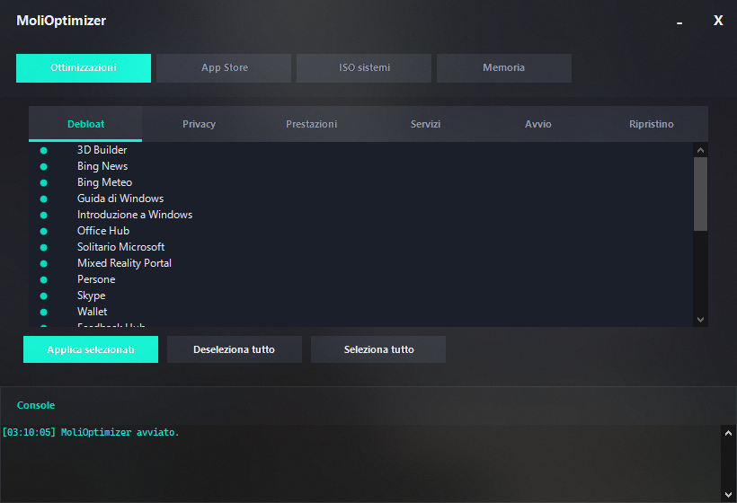

# 🚀 MoliOptimizer

**MoliOptimizer** è un potente strumento di ottimizzazione per Windows con interfaccia grafica moderna in stile dark. Progettato per migliorare le prestazioni del sistema, la privacy e la gestione della memoria attraverso tweak di registro, servizi e pulizia della RAM.

## 📸 Screenshot

  

## ✨ Caratteristiche

### 🎯 Ottimizzazioni
- **Debloat Windows**: Rimozione di app preinstallate non necessarie
- **Privacy**: Disattivazione telemetria, Cortana, pubblicità personalizzata e tracking
- **Prestazioni**: Tweak di sistema, pianificazione CPU/GPU, disabilitazione effetti visivi
- **Servizi**: Configurazione intelligente dei servizi di sistema
- **Avvio**: Disabilitazione programmi in avvio automatico
- **Ripristino**: Backup e ripristino delle ottimizzazioni applicate

### 💾 Gestione Memoria
- Pulizia cache del registro
- Flush dei file modificati
- Svuotamento working set dei processi
- Ottimizzazione cache file di sistema
- Monitoraggio in tempo reale della RAM

### 📦 App Store
- Installazione di oltre 80 applicazioni tramite **winget**
- Categorie: Code, Video, Social, Browser, Utility, Gaming, Media, Productivity, Cloud, Network, Security
- Interfaccia a griglia con icone e selezione multipla

### 💿 Download ISO
- Collegamenti diretti a download ufficiali di:
  - Windows 10/11
  - Distribuzioni Linux (Ubuntu, Fedora, Arch, Debian, ecc.)
  - Tool di recovery e virtualizzazione

## 📋 Requisiti

- **Windows 10** (1809+) o **Windows 11**
- **PowerShell 5.1** o superiore
- **Esecuzione come Amministratore** (richiesta automaticamente)
- **winget** (opzionale, per l'installazione delle app)

## 🚀 Installazione

### Download diretto
Scarica l'ultima release da [GitHub Releases](https://github.com/Molinays/MoliOptimizer/releases)
