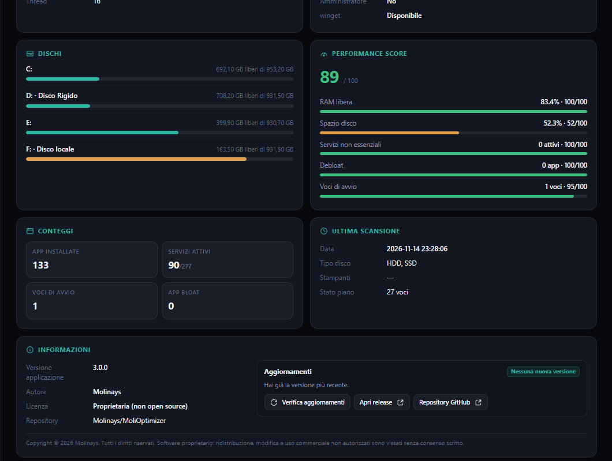

<p align="center">
  
</p>

<h1 align="center">MoliOptimizer (Windows)</h1>

<p align="center">
  <strong>WINDOWS OPTIMIZATION SUITE</strong><br>
  Piano personalizzato, privacy, prestazioni, debloat e pulizia in un'unica app.
</p>

<p align="center">
  
  
  
  
  
</p>

<p align="center">
  <a href="https://github.com/Molinays/MoliOptimizer/releases/latest"><strong>Download</strong></a>
  &nbsp;·&nbsp;
  <a href="#funzioni">Funzioni</a>
  &nbsp;·&nbsp;
  <a href="#sicurezza-e-ripristino">Sicurezza</a>
  &nbsp;·&nbsp;
  <a href="#licenza">Licenza</a>
</p>

> **MoliOptimizer è software proprietario, non open source.** Il repository non concede diritti di modifica o ridistribuzione del codice. Vedi la sezione [Licenza](#licenza).

---

## Download

<p align="center">
  <a href="https://github.com/Molinays/MoliOptimizer/releases/latest">
    
  </a>
  <a href="https://github.com/Molinays/MoliOptimizer/releases/latest">
    
  </a>
  <a href="https://github.com/Molinays/MoliOptimizer/releases/latest">
    
  </a>
</p>

| Pacchetto | Formato | Piattaforma | Ideale per | Download |
|---|---|---|---|---|
| **MoliOptimizer** · `MoliOptimizer.exe` | `.exe` singolo | Windows 10/11 x64 | Esperienza web moderna, un solo file | [Vai alla release](https://github.com/Molinays/MoliOptimizer/releases/latest) |
| **MoliOptimizer Web Host** · `MoliOptimizer-Web.exe` | `.exe` + cartella di supporto | Windows 10/11 x64 | Avvio rapido con pacchetto web separato | [Vai alla release](https://github.com/Molinays/MoliOptimizer/releases/latest) |
| **MoliOptimizerFast IT** · `MoliOptimizerFast-IT.exe` | `.exe` | Windows 7/10, PowerShell 5.1 | PC datati, nessun WebView2 | [Vai alla release](https://github.com/Molinays/MoliOptimizer/releases/latest) |
| **MoliOptimizerFast EN** · `MoliOptimizerFast-EN.exe` | `.exe` | Windows 7/10, PowerShell 5.1 | PC datati, interfaccia inglese | [Vai alla release](https://github.com/Molinays/MoliOptimizer/releases/latest) |

Nessun installer: l'app è portabile. L'edizione web richiede il **WebView2 Runtime** (già presente su Windows 10/11 aggiornati). Il file singolo estrae il payload in `%LOCALAPPDATA%\MoliOptimizer\WebSingle\` al primo avvio. La versione Web Host va eseguita dalla propria cartella, senza spostare il solo `.exe`.

---

## Perché MoliOptimizer?

- **Piano su misura, non un elenco fisso.** La scansione legge hardware, dischi, RAM, app installate, servizi e voci di avvio, poi propone solo le ottimizzazioni adatte a quel PC.
- **Niente modifiche silenziose.** Ogni operazione richiede selezione e conferma esplicita. La scansione iniziale è in sola lettura.
- **Due edizioni, stesso motore.** Web moderna per Windows 10/11 e Fast nativa per PC vecchi, con gli stessi cataloghi e gli stessi backup.
- **Privacy e reattività.** Tweak mirati per telemetria, pubblicità, suggerimenti, Game Bar, ricerca, clipboard, input, servizi e latenza di rete.
- **Pulizia e RAM incluse.** Cache delle app, file temporanei, debloat selettivo, ottimizzazione RAM e deep clean restano disponibili.
- **Backup e ripristino.** Prima delle modifiche viene creato un punto di ripristino quando possibile; registro, servizi, avvio e alimentazione vengono salvati per il rollback.
- **App Store, ISO e Playbook.** Cataloghi integrati per installare software, scaricare ISO ufficiali e consultare tool e progetti della community.

---

## Uno sguardo all'app

<p align="center">
  
</p>

<p align="center">
  <em>Piano personalizzato: punteggio del PC, RAM libera, cache recuperabile e voci divise per tipo.</em>
</p>

### Piano e ottimizzazioni

La scheda **Per il tuo PC** costruisce un piano dinamico in base all'hardware e alle app rilevate. Ogni voce mostra il tipo di intervento e, quando disponibile, lo spazio recuperabile. Il footer con **Applica consigliati** resta sempre visibile.

### Info, versione e aggiornamenti

<p align="center">
  
</p>

<p align="center">
  <em>Hardware, dischi, punteggio, conteggi, versione, licenza e controllo aggiornamenti GitHub.</em>
</p>

> Le schermate mostrano l'edizione web. **MoliOptimizerFast** usa la stessa logica con una finestra WinForms nativa, senza WebView2.

---

## Funzioni

### Piano personalizzato

- Scansione di CPU, GPU, RAM, dischi, sistema operativo, app installate, servizi e voci di avvio.
- Punteggio con dettaglio per memoria, spazio disco, servizi non essenziali, debloat e avvio.
- Piano costruito sul PC reale, non un preset uguale per tutti.
- Profilo CPU/GPU (AMD, Intel, NVIDIA) e tweak mirati quando presenti e supportati: HAGS per GPU compatibili, ULPS AMD desktop, piano Ryzen, boost CPU e telemetria NVIDIA.
- Applicazione selettiva: nessuna modifica parte senza scelta e conferma.

### Privacy

- Telemetria, ID pubblicitario, suggerimenti Start/Store e contenuti cloud.
- Timeline, ricerca web nel menu Start, widget, Copilot e Recall su Windows 11.
- Cronologia appunti cloud, raccolta input/inchiostro e schermata di blocco Spotlight.
- AutoPlay/AutoRun, SMB1, WPAD, Assistenza remota e Desktop remoto.
- Tweak separati per chi vuole un profilo più prudente o più aggressivo.

### Prestazioni e reattività

- Piano energetico, Fast Startup, TRIM, Core Parking e priorità foreground.
- Game Mode, Game DVR/Bar, MMCSS, QoS riservata e Nagle TCP.
- Menu senza ritardo, chiusura app più rapida e animazioni della taskbar.
- Prefetch/Superfetch e Edge Startup Boost per chi accetta un profilo avanzato.
- Verifica del valore scritto per i tweak di registro; gli errori non vengono presentati come successi.

### Debloat

- Rimozione delle app preinstallate selezionate tramite `Remove-AppxPackage` e `Remove-AppxProvisionedPackage`.
- Le voci protette o non rimosse vengono segnalate, non conteggiate come completate.
- Ripristino tramite backup di sistema o reinstallazione manuale dallo Store.

### Servizi Windows

- Impostazione del tipo di avvio: automatico, manuale o disabilitato.
- Arresto dei servizi disabilitati e verifica finale dello stato.
- Backup dello stato precedente per il ripristino.
- I servizi protetti da Windows vengono saltati senza bloccare il resto del piano.

### Avvio

- Lettura delle voci attive in `HKCU`, `HKLM` e `HKLM\WOW6432Node`.
- Esclusione delle pseudo-proprietà PowerShell e delle voci già disattivate.
- Disattivazione tramite `StartupApproved\Run` o `StartupApproved\Run32`.
- Verifica reale della scrittura e rimozione dall'elenco delle voci attive.

### Pulizia, RAM e deep clean

- Cache, file temporanei e residui delle applicazioni.
- Dimensioni reali e cache delle app rilevate dopo la scansione.
- Le cartelle in uso possono essere saltate; il risultato riporta lo spazio effettivamente liberato.
- Ottimizzazione RAM e deep clean restano disponibili e non sono stati ridotti.

### App Store, ISO e Playbook

- App Store con catalogo winget e icone locali.
- ISO con link ai download ufficiali.
- Playbook con progetti e tool della community.
- Ricerca e filtri locali, interfaccia IT/EN.

### Ripristino

- Ripristino del backup creato prima delle ottimizzazioni.
- Ripristino dei valori predefiniti di Windows per i tweak applicati.
- Servizi, voci di avvio e valori di registro salvati vengono riapplicati dal backup.
- Le app rimosse con Debloat richiedono una reinstallazione manuale.

---

## Due edizioni

| | **MoliOptimizer Web** | **MoliOptimizerFast** |
|---|---|---|
| Interfaccia | HTML/CSS/JS in WebView2 | WinForms nativa |
| Windows | 10/11 x64 | 7/10, 32 o 64 bit |
| Runtime | WebView2 Runtime | PowerShell 5.1 |
| Installazione | Nessun installer; file singolo o cartella portabile | Nessun installer |
| Lingua | Toggle IT/EN a runtime | Build IT ed EN separate |
| Ideale per | PC moderni e UI più aggiornabile | PC datati e ambienti senza WebView2 |
| Motore | PowerShell modulare | PowerShell modulare |
| Backup | Sì | Sì |

Entrambe le edizioni usano lo stesso motore, gli stessi cataloghi e lo stesso formato di backup. La web è più comoda da aggiornare; Fast è la scelta quando WebView2 non è disponibile o le risorse sono limitate.

---

## Sicurezza e ripristino

- La scansione iniziale **non modifica** il sistema.
- Le operazioni privilegiate richiedono **UAC/amministratore**.
- Prima delle modifiche viene creato, quando possibile, un **punto di ripristino di Windows**.
- MoliOptimizer salva in `%ProgramData%\MoliOptimizer\optimization-backup.xml`:
  - valori di registro precedenti;
  - stato e tipo di avvio dei servizi;
  - stato `StartupApproved` delle voci di avvio;
  - piano energetico, ibernazione, Core Parking e Dynamic Tick.
- La funzione **Ripristina** usa questo backup.
- Le modifiche più aggressive sono manuali e chiaramente etichettate; le app rimosse con Debloat non sono ripristinabili automaticamente.
- L'app non installa servizi persistenti, driver o componenti di controllo remoto.

> Le ottimizzazioni modificano registro, servizi e alimentazione. Usa l'app su un PC di cui hai il controllo e leggi sempre la descrizione della voce prima di applicarla.

---

## Requisiti

### Edizione web

- Windows 10 o Windows 11 aggiornato, x64.
- WebView2 Runtime. Su Windows 10/11 recenti è già presente; se manca, l'app lo segnala.
- Nessun runtime Node o Electron richiesto per usare l'exe.
- Per la build Tauri opzionale: Rust, MSVC Build Tools e WebView2.

### MoliOptimizerFast

- Windows 7 o Windows 10, 32 o 64 bit.
- PowerShell 5.1.
- Nessuna dipendenza da WebView2, Electron o runtime esterni.
- Le operazioni su registro, servizi, Appx e alimentazione richiedono elevazione.

La durata della scansione dipende da CPU, disco, servizi e app installate. Il piano viene calcolato localmente.

---

## Come si usa

1. Avvia l'app.
2. Premi **Scansiona il PC**.
3. Controlla il piano nella scheda **Per il tuo PC**.
4. Apri Debloat, Privacy, Prestazioni, Servizi, Avvio o Pulizia per scegliere le singole voci.
5. Seleziona le voci e premi **Applica**.
6. Controlla il risultato nella console e nella notifica finale.
7. Usa **Ripristina** se vuoi tornare allo stato precedente.

L'app non applica nulla senza una selezione esplicita e una conferma. Le operazioni privilegiate possono richiedere UAC.

---

## Aggiornamenti

La versione applicazione è **3.0.0**. La release più recente è disponibile su GitHub:

https://github.com/Molinays/MoliOptimizer/releases/latest

- **Web:** la scheda Info controlla `releases/latest`, mostra la versione corrente e segnala se esiste una release più nuova.
- **MoliOptimizerFast:** la scheda Info mostra versione, autore e licenza; il pulsante **Verifica aggiornamenti** interroga GitHub.
- Se GitHub non è raggiungibile, l'app resta utilizzabile e mostra **Controllo non disponibile**. Il collegamento alla pagina release resta disponibile.

MoliOptimizer non installa aggiornamenti in background e non esegue modifiche automatiche.

---

## Sviluppo e build

<details>
<summary>Comandi per i maintainer</summary>

La build vive nella cartella `build/`; il motore resta modulare in `src/`. La cartella `Old/` contiene solo versioni storiche e non viene usata dalla build.

```powershell
# Build completa: Fast IT, Fast EN e web
.\build\Build-All.ps1

# Solo MoliOptimizerFast
.\build\Build-Exe.ps1 -Lang IT
.\build\Build-Exe.ps1 -Lang EN

# Web con guscio WebView2, senza Rust/MSVC
.\build\Build-WebHost.ps1

# Web con Tauri, se Rust e MSVC sono disponibili
.\build\Build-Web.ps1

# Web in un solo file: UI, motore e DLL incorporati
.\build\Build-WebSingle.ps1
```

Per l'anteprima web:

```powershell
cd web
npm run dev
# http://127.0.0.1:5178
```

Verifiche principali:

```powershell
.\build\Test-Syntax.ps1
.\build\Test-SearchFilters.ps1
.\build\Test-Startup.ps1
```

Se un exe è aperto, la build deve fallire con un messaggio chiaro: non dichiarare mai un falso successo.

</details>

---

## Licenza

**MoliOptimizer è software proprietario. Non è open source.**

Copyright © 2026 Molinays. Tutti i diritti riservati.

Nessun permesso è concesso per usare, copiare, modificare, unire, pubblicare, distribuire, sublicenziare o vendere il codice sorgente, in tutto o in parte, senza il consenso scritto preventivo di Molinays.

L'applicazione compilata può essere usata per scopi personali o aziendali interni. La ridistribuzione dell'applicazione compilata, con o senza modifiche, richiede il consenso scritto preventivo di Molinays.

Il testo completo è disponibile in [LICENSE](LICENSE).

Per permessi e richieste: apri una issue nel repository o contatta **Molinays**.

---

## Disclaimer

MoliOptimizer non è affiliato a Microsoft. Windows è un marchio di Microsoft Corporation.

Le ottimizzazioni possono modificare il comportamento del sistema operativo. Verifica sempre il piano, usa il ripristino disponibile e non applicare voci che non comprendi. L'uso dell'app avviene a tuo rischio.

<p align="center">
  <strong>Made by Molinays</strong><br>
  <sub>MoliOptimizer v3 · Windows Optimization Suite</sub>
</p>
