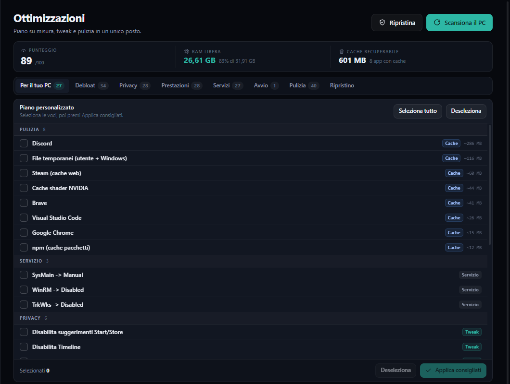

<p align="center">
  
</p>

<h1 align="center">MoliOptimizer v3</h1>

<p align="center">
  Ottimizzatore per Windows con due edizioni: una GUI web moderna e una GUI classica WinForms<br>
  per PC molto vecchi. Stesso motore PowerShell, stessi cataloghi, stessi backup.
</p>

---

## Panoramica

MoliOptimizer analizza il PC, costruisce un piano personalizzato e applica solo le voci selezionate dall'utente. Ogni modifica al sistema viene registrata nel backup di ottimizzazione e può essere ripristinata dall'app.

Le due edizioni sono:

| Edizione | Interfaccia | Requisiti | Output |
|---|---|---|---|
| **Web — MoliOptimizer** | HTML/CSS/JS in WebView2, con guscio WebView2 nativo oppure Tauri 2 | Windows 10/11, WebView2 Runtime | `dist/v3/MoliOptimizer.exe` in un solo file, oppure `dist/v3/web/MoliOptimizer-Web.exe` + supporto |
| **PowerShell — MoliOptimizerFast** | Finestra WinForms nativa | Windows 7/10, PowerShell 5.1, nessun WebView2 | `dist/v3/classic/MoliOptimizerFast-IT.exe` e `MoliOptimizerFast-EN.exe` |

La versione stabile è in `dist/`; la v3 in `dist/v3/`. La cartella `Old/` contiene solo versioni storiche e non viene usata dalla build.

### Quale edizione è più sostenibile

Per la manutenzione della GUI, **WebView2 è più sostenibile**: la UI è la stessa dell'anteprima web, si aggiorna una volta sola e non richiede di duplicare ogni schermata in WinForms. Il prezzo è il requisito Windows 10/11 + WebView2 Runtime.

**MoliOptimizerFast** è più sostenibile per la compatibilità: gira su Windows 7/10, non richiede WebView2 ed è il client da usare su PC vecchi o molto limitati. Il prezzo è la doppia UI WinForms e una maggiore esposizione alle euristiche degli antivirus per via di `ps2exe`.

La scelta consigliata è tenere entrambi i client sullo stesso motore `src/`: Web per l'uso moderno, Fast per la compatibilità. Non esiste un singolo binario che garantisca “qualsiasi PC” e insieme la UI web moderna. Se si dovesse scegliere un solo client per il futuro, sceglierei WebView2; Fast va mantenuto solo se Windows 7/10 senza WebView2 è un requisito commerciale.

## Immagini dell'edizione web

Le schermate mostrano l'edizione web. MoliOptimizerFast usa lo stesso motore, gli stessi cataloghi e gli stessi backup, con una finestra WinForms nativa.

### Piano personalizzato e ottimizzazioni



La scheda **Per il tuo PC** mostra le voci consigliate su una sola riga, con tipo, dimensione recuperabile e checkbox. Il footer con **Applica consigliati** resta sempre visibile; la lista scorre internamente.

### Info, versione, licenza e aggiornamenti


La scheda **Info** include hardware, sistema operativo, dischi, punteggio, conteggi e il riquadro applicazione con versione, autore, licenza proprietaria, repository e controllo aggiornamenti GitHub.

## Funzioni principali

### Piano personalizzato

- Scansione di hardware, memoria, dischi, app installate, servizi e voci di avvio.
- Punteggio con dettaglio per RAM, spazio disco, servizi non essenziali, debloat e avvio.
- Piano costruito in base al PC, non un elenco fisso.
- Applicazione selettiva: nessuna modifica parte senza scelta e conferma.

### Privacy e prestazioni

- Tweak di registro per telemetria, pubblicità, suggerimenti, ricerca, Game Bar e funzioni Windows 11.
- Tweak prestazioni per piano energetico, Fast Startup, indicizzazione, TRIM, Core Parking e memoria.
- Verifica del valore scritto per i tweak di registro; gli errori vengono riportati nella console e non vengono presentati come successi.

### Debloat

- Rimozione delle app preinstallate selezionate tramite `Remove-AppxPackage` e `Remove-AppxProvisionedPackage`.
- Le voci protette o non rimosse vengono segnalate come errore, non come completate.
- Ripristino tramite il backup di sistema o reinstallazione manuale dallo Store.

### Servizi Windows

- Impostazione del tipo di avvio: automatico, manuale o disabilitato.
- Arresto dei servizi disabilitati.
- Verifica finale del tipo di avvio e dello stato; un servizio ancora attivo viene segnalato.
- Backup dello stato precedente per il ripristino.

### Avvio

- Lettura delle voci **attive** in:
  - `HKCU\Software\Microsoft\Windows\CurrentVersion\Run`
  - `HKLM\Software\Microsoft\Windows\CurrentVersion\Run`
  - `HKLM\Software\WOW6432Node\Microsoft\Windows\CurrentVersion\Run` per le app a 32 bit
- Esclusione delle pseudo-proprietà PowerShell come `PSDrive`.
- Le voci già disattivate non vengono conteggiate come attive.
- Disattivazione tramite `StartupApproved\Run` o `StartupApproved\Run32`.
- Verifica reale della scrittura e rimozione dall'elenco delle voci attive.
- Backup del valore `StartupApproved` per il ripristino.

### Pulizia

- Pulizia di cache, file temporanei e residui delle applicazioni.
- Dimensioni reali e cache delle app rilevate dopo la scansione.
- Selezione separata tra voci di pulizia e cache delle applicazioni.
- Le cartelle in uso possono essere saltate; il risultato riporta lo spazio effettivamente liberato.

### RAM e deep clean

L'ottimizzazione RAM e il deep clean restano disponibili e non sono stati ridotti. Il comando richiede i privilegi necessari e usa il worker elevato quando serve.

### App Store, ISO e Playbook

- App Store con catalogo winget e icone locali.
- ISO con link ai download ufficiali.
- Playbook con progetti e tool della community.
- Ricerca e filtri locali.

### Ripristino

- Ripristino del backup creato prima delle ottimizzazioni.
- Ripristino dei valori predefiniti di Windows per i tweak applicati.
- I servizi, le voci di avvio e i valori di registro salvati vengono riapplicati dal backup.

## Requisiti

### Edizione web

- Windows 10 o Windows 11 aggiornato.
- WebView2 Runtime. Su Windows 10/11 recenti è già presente; se manca, l'app lo segnala.
- Nessun runtime Node o Electron richiesto per usare l'exe.
- Per la build Tauri: Rust, MSVC Build Tools e WebView2.

### Edizione MoliOptimizerFast (PowerShell)

- Windows 7 o Windows 10, 32 o 64 bit.
- PowerShell 5.1.
- Nessuna dipendenza da WebView2, Electron o runtime esterni.
- Le operazioni su registro, servizi, Appx e alimentazione richiedono l'elevazione.

Non esiste un binario universale per ogni PC: MoliOptimizerFast richiede Windows e PowerShell 5.1; l'edizione web richiede Windows 10/11 e WebView2 Runtime. La scansione del motore misurata su questa macchina è di circa 4,8 secondi, ma il tempo reale dipende da CPU, disco, servizi e app installate.

## Download e installazione

Le release sono pubblicate su:

https://github.com/Molinays/MoliOptimizer/releases

Scarica l'artefatto adatto:

- `MoliOptimizer.exe` per l'edizione web in un solo file, senza cartella di supporto.
- `MoliOptimizer-Web.exe` e la sua cartella di supporto per l'edizione web tradizionale.
- `MoliOptimizerFast-IT.exe` o `MoliOptimizerFast-EN.exe` per l'edizione PowerShell.

L'eseguibile web tradizionale va eseguito dalla propria cartella, insieme a `ui`, `src`, `bridge.ps1` e alle DLL WebView2. Non spostare il solo `.exe`. L'edizione web richiede Windows 10/11 a 64 bit e il WebView2 Runtime.

Il file **MoliOptimizer.exe** contiene UI, motore, bridge, helper e DLL WebView2 nello stesso file. Al primo avvio estrae il payload in `%LOCALAPPDATA%\MoliOptimizer\WebSingle\` e avvia la GUI. Serve comunque il **WebView2 Runtime** installato: non è incorporato nel runtime di Windows. Il file singolo è pensato per la distribuzione semplice, non per aggirare SmartScreen.

## Come si usa

1. Avvia l'app.
2. Premi **Scansiona il PC**.
3. Controlla il piano nella scheda **Per il tuo PC**.
4. Apri le schede Debloat, Privacy, Prestazioni, Servizi, Avvio o Pulizia per scegliere le singole voci.
5. Seleziona le voci e premi **Applica**.
6. Controlla il risultato nella console e nella notifica finale.
7. Usa **Ripristina** se vuoi tornare allo stato precedente.

L'app non applica nulla senza una selezione esplicita e una conferma. Le operazioni privilegiate possono richiedere UAC.

## Permessi

- **Sola lettura**: la scansione e l'analisi funzionano senza elevazione.
- **Amministratore**: necessario per registro HKLM, servizi, Appx e alimentazione.
- Nell'edizione web il pulsante **Richiedi admin** avvia un worker PowerShell elevato persistente; la GUI resta a integrità normale.
- Il deep clean RAM può richiedere un prompt UAC separato se la sessione elevata non è attiva.

## Backup e reversibilità

Prima delle modifiche viene creato, quando possibile, un punto di ripristino di Windows. Inoltre MoliOptimizer salva in `%ProgramData%\MoliOptimizer\optimization-backup.xml`:

- valori di registro precedenti;
- stato e tipo di avvio dei servizi;
- stato `StartupApproved` delle voci di avvio;
- piano energetico, ibernazione, Core Parking e Dynamic Tick.

Il backup viene usato dalla funzione **Ripristina**. Le app rimosse con Debloat richiedono una reinstallazione manuale.

## Aggiornamenti

La versione applicazione è **3.0.0**. La release più recente è disponibile su GitHub.

- **Web**: la scheda Info controlla `releases/latest` di GitHub, mostra la versione corrente e segnala se esiste una release più nuova. Il controllo automatico viene eseguito all'avvio della GUI; il pulsante **Verifica aggiornamenti** forza un nuovo controllo.
- **MoliOptimizerFast**: la scheda Info mostra versione, autore e licenza; il pulsante **Verifica aggiornamenti** interroga GitHub con PowerShell e mostra l'esito.
- Se GitHub non è raggiungibile, l'app resta utilizzabile e mostra **Controllo non disponibile**. Il collegamento alla pagina release resta disponibile.

## Build

Dalla radice del progetto:

```powershell
# Build completa: Fast IT, Fast EN e web
.\build\Build-All.ps1

# Solo MoliOptimizerFast
.\build\Build-Exe.ps1 -Lang IT
.\build\Build-Exe.ps1 -Lang EN

# Web con guscio WebView2, senza Rust/MSVC
.\build\Build-WebHost.ps1

# Web con Tauri, se Rust e MSVC sono disponibili
.\build\Build-Web.ps1

# Web in un solo file: UI, motore e DLL incorporati
.\build\Build-WebSingle.ps1
```

`Build-All.ps1` produce sempre gli artefatti richiesti. Usa Tauri se il toolchain Rust/MSVC è presente; altrimenti usa il guscio WebView2. La build in un solo file è un passaggio separato perché incorpora il pacchetto web già costruito e richiede il WebView2 Runtime sul PC di destinazione.

Per firmare anche i componenti interni del file singolo, firma prima il pacchetto web e poi crea il launcher senza ricompilarlo:

```powershell
.\build\Build-WebHost.ps1
.\build\Sign-Release.ps1 -Thumbprint "THUMBPRINT" -Root "dist\v3\web"
.\build\Build-WebSingle.ps1 -SkipHostBuild
.\build\Sign-Release.ps1 -Thumbprint "THUMBPRINT" -Root "dist\v3"
```

La firma del solo `MoliOptimizer.exe` non rende firmati i file estratti dal payload.

### Anteprima web di sviluppo

```powershell
cd web
npm run dev
# http://127.0.0.1:5178
```

Il dev server inoltra `POST /api/engine` a `bridge.ps1` e mostra dati reali del PC.

## Verifiche

```powershell
# Sintassi dei moduli e dei bundle
.\build\Test-Syntax.ps1

# Filtri App Store, ISO e Playbook
.\build\Test-SearchFilters.ps1

# Test non distruttivo della disattivazione Avvio
.\build\Test-Startup.ps1

# Rigenera cataloghi e dizionario EN dopo modifiche a src/data o src/lang
cd web
npm run catalog
```

Il test `Test-Startup.ps1` crea una voce temporanea in `HKCU Run`, la disattiva, verifica `StartupApproved`, controlla che sparisca dalle voci attive e rimuove tutto. Non tocca le voci reali.

## Struttura

```text
src/                  motore PowerShell modulare
  app/                avvio, splash, finestra
  core/               piano, backup, pulizia, i18n, logging, helper
  data/               cataloghi debloat, tweak, servizi, pulizia, app, ISO, playbook
  features/           scansione, applicazione, ripristino, RAM, winget
  lang/               dizionari IT/EN
  ui/                 viste WinForms classiche
web/                  GUI web
  ui/                 HTML, CSS, JS, catalog.json, i18n.json, icone
  bridge.ps1          API JSON stdin/stdout verso il motore
  host/               guscio WinForms + WebView2
  src-tauri/          guscio Tauri 2
  tools/              dev server, export cataloghi, icone
build/                pipeline, test e build
dist/                 distribuzione
  v3/classic/         eseguibili classici IT/EN
  v3/web/             eseguibile web + supporto
docs/images/          immagini del README
Old/                  versioni storiche, non usate dalla build
```

## Crediti

- **Sviluppo e progetto**: Molinays.
- **Repository pubblico**: https://github.com/Molinays/MoliOptimizer
- **Icona**: icona storica della v1, `build/assets/molioptimizer-v1.ico`.
- **Catalogo applicazioni**: winget e siti ufficiali dei produttori.
- **ISO e playbook**: link ai progetti e ai repository originali.

## Licenza

MoliOptimizer è **software proprietario**. **Non è open source.**

Copyright © 2026 Molinays. Tutti i diritti riservati.

Sono vietati senza consenso scritto la ridistribuzione, la modifica, la vendita e l'uso commerciale del codice. Il testo completo è in [LICENSE](LICENSE).

## Firma, SmartScreen e falsi positivi

Un eseguibile non firmato può essere segnalato da Microsoft Defender come `Trojan:Win32/Wacatac.B!ml`. È una rilevazione euristica: non dimostra da sola che il file sia malevolo, ma va verificata. Non disattivare Defender e non aggiungere esclusioni per distribuire l'app.

Se prima dell'avvio compare **Windows protected your PC**, si tratta di SmartScreen: il file scaricato non ha un publisher riconosciuto o non ha ancora reputazione. Non si elimina con una modifica al codice e non va aggirato dicendo all'utente di disattivare SmartScreen. Serve la firma trusted, poi la reputazione cresce con download e segnalazioni; in alternativa si distribuisce tramite Microsoft Store/MSIX firmato.

La soluzione corretta è firmare gli artefatti con un certificato di code signing trusted e inviare il falso positivo a Microsoft. Un certificato self-signed non è valido per il pubblico: mostra un editor sconosciuto e non costruisce reputazione.

### Certificato

- **Azure Artifact Signing** (ex Trusted Signing): piano Basic da circa 9,99 USD al mese, 5.000 firme, nessun token hardware. Le organizzazioni con sede in UE, Regno Unito, USA e Canada sono ammesse; gli individui solo in USA e Canada. Per una società italiana è la soluzione più semplice per gli exe.
- **Certificato OV da una CA** (DigiCert, Sectigo, Certum e altre): valido in tutto il mondo, richiede verifica dell'identità e chiave privata su token o cloud HSM. È la strada per un privato non residente in USA/Canada. Un certificato EV non garantisce più da solo l'assenza immediata di SmartScreen.
- Il nome visualizzato deve corrispondere all'entità verificata. Se `Molinays` non è un'entità legale registrata, il certificato può essere intestato alla persona fisica, non a un nome inventato.

`Sign-Release.ps1` usa un certificato con chiave privata visibile nel wallet Windows e firma sia PE sia script. Per Azure Artifact Signing si usa l'integrazione PowerShell/SignTool dedicata: non è lo stesso flusso locale. Se vuoi un solo flusso per exe e ps1, un certificato CA con chiave privata nel wallet è il percorso più diretto.

Se il certificato è disponibile come PFX o il provider lo espone nel wallet:

```powershell
Import-PfxCertificate -FilePath .\Molinays-CodeSigning.pfx -CertStoreLocation Cert:\CurrentUser\My
Get-ChildItem Cert:\CurrentUser\My -CodeSigningCert | Format-List Subject,Thumbprint,NotAfter,HasPrivateKey
```

Per un OV pubblico moderno la chiave privata risiede su token o cloud HSM; il certificato deve comparire in `Cert:\CurrentUser\My` con `HasPrivateKey=True`. Non salvare il PFX o la password nel repository.

### Firma della build

```powershell
.\build\Build-All.ps1 -SignThumbprint "THUMBPRINT"
```

La build, dopo aver creato IT, EN e web, firma con SHA-256 e timestamp:

- `MoliOptimizerFast-IT.exe` e `MoliOptimizerFast-EN.exe`;
- `MoliOptimizer-Web.exe`;
- tutti i file `.ps1`, `.psm1` e `.psd1` della distribuzione, compresi `bridge.ps1` e gli helper di elevazione;
- genera `dist\v3\SHA256SUMS.txt`.

Per firmare una cartella già costruita:

```powershell
.\build\Sign-Release.ps1 -Thumbprint "THUMBPRINT"
```

Se il certificato non è nel wallet, lo script si ferma con un errore: non crea certificati fittizi e non dichiara una firma valida senza certificato.

### Falso positivo

Dopo la firma, invia il file firmato e il suo SHA-256 a Microsoft:

https://www.microsoft.com/en-us/wdsi/filesubmission

Seleziona la segnalazione come falso positivo, indica `Trojan:Win32/Wacatac.B!ml`, la versione, il comando usato e il fatto che l'app è un ottimizzatore Windows firmato. La risposta non è immediata. La reputazione SmartScreen si costruisce nel tempo con download e segnalazioni; la firma riduce i blocchi ma non garantisce l'assenza di avvisi dal primo giorno.

Per **McAfee** e **SecureAge** la procedura, i moduli ufficiali, gli hash correnti e un testo pronto per la segnalazione sono in [docs/security/false-positive-mcafee-secureage.md](docs/security/false-positive-mcafee-secureage.md). McAfee usa il modulo **Dispute a Detection & Allowlisting**; SecureAge richiede uno ZIP protetto dalla password `infected`. Inviare la build **firmata**, non quella attuale non firmata, perché la whitelist è legata all'hash.

`ps2exe` è un wrapper PowerShell spesso usato da malware e può continuare a attirare euristiche anche dopo la firma. Se Microsoft conferma il falso positivo ma la detenzione resta, la soluzione strutturale è distribuire la classica con un host .NET firmato invece del solo wrapper `ps2exe`, oppure passare a un pacchetto MSIX/Microsoft Store. Non usare offuscamento o packer per aggirare il controllo.

## Release e archivio sorgenti

GitHub genera automaticamente, per ogni release di un repository pubblico, i collegamenti **Source code (zip)** e **Source code (tar.gz)**. Non sono asset caricati dall'autore e non possono essere disattivati o eliminati dal repository pubblico. `.gitattributes` con `export-ignore` non li rimuove: vale per `git archive`, non per gli archivi automatici delle release.

Per distribuire solo i binari:

1. **Repository privato**: mantieni il codice in un repository privato e pubblicalo solo a chi deve accedervi.
2. **Repository pubblico di distribuzione**: crea un repository separato, per esempio `MoliOptimizer-Releases`, con README, binari e checksum. Il codice resta nel repository privato; l'archivio sorgente automatico del repository di distribuzione contiene solo i file pubblici.
3. **Download esterno**: pubblica i binari su un sito o un CDN e lascia il repository del codice privato.

Per ogni release è consigliato allegare:

- eseguibili IT, EN e web;
- checksum SHA-256;
- note di rilascio;
- requisiti e istruzioni di installazione.

## Note

- MoliOptimizerFast è pensata per PC molto vecchi e non usa WebView2.
- L'edizione web con guscio WebView2 è quella compilata su questa macchina; la build Tauri richiede Rust e MSVC e non è inclusa negli artefatti attuali.
- Il deep clean RAM è una funzione consolidata e resta invariato.
- Le immagini del README sono catturate dalla GUI web reale.
